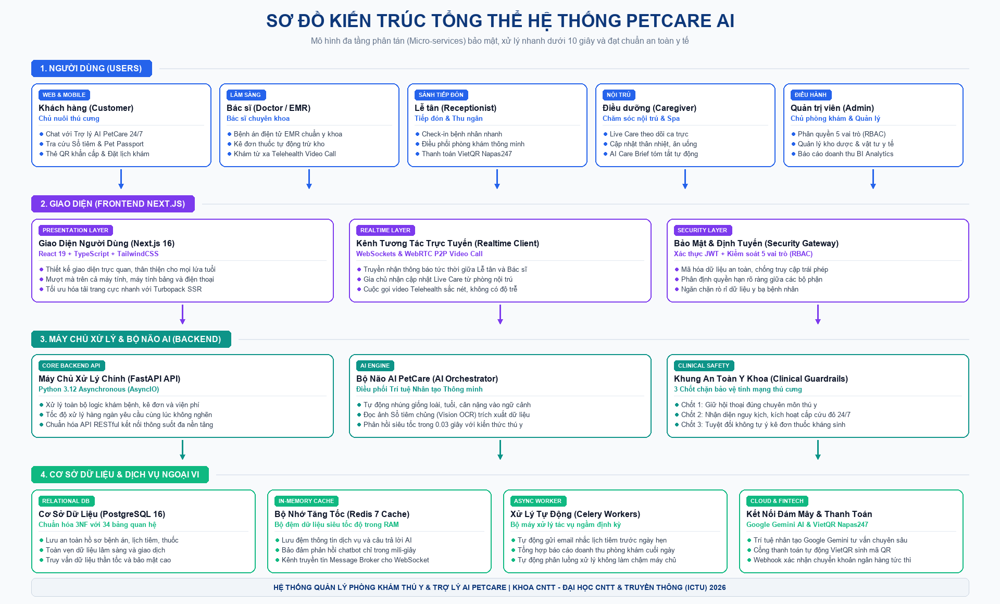
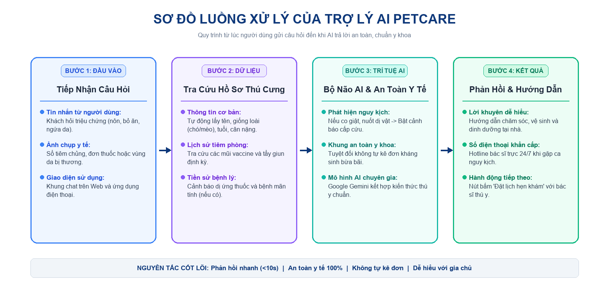

# HỆ THỐNG QUẢN LÝ THÚ CƯNG VÀ LỊCH CHĂM SÓC CÓ TÍCH HỢP AI

[](https://fastapi.tiangolo.com)
[](https://nextjs.org)
[](https://www.postgresql.org)
[](https://redis.io)
[](https://www.docker.com)
[](https://deepmind.google/technologies/gemini)

Nền tảng Quản lý Bệnh viện Thú y, Đặt lịch Khám & Chăm sóc Thú cưng Toàn diện Tích hợp Trí tuệ Nhân tạo Đa tầng (PetCare AI Realtime Ecosystem).

---

## 🏛️ Sơ Đồ Kiến Trúc Hệ Thống (System Architecture)



Hệ thống được thiết kế theo mô hình 4 tầng độc lập, bảo mật và chịu tải cao:
1. **Tầng 1 (Người dùng đa vai trò)**: 5 nhóm người dùng tương ứng với 5 phân hệ chuyên biệt (Khách hàng, Bác sĩ thú y, Lễ tân phòng khám, Điều dưỡng/Người chăm sóc, Quản trị viên).
2. **Tầng 2 (Giao diện ứng dụng & Realtime)**: Xây dựng trên nền tảng Next.js 14 App Router, WebSockets hai chiều, WebRTC Video Call P2P HD, xác thực phân quyền RBAC và JWT Guard.
3. **Tầng 3 (Máy chủ xử lý & Bộ não AI)**: FastAPI Python AsyncIO tốc độ cao kết hợp Bộ não AI (AI Orchestrator) gồm 3 chốt an toàn y khoa (Clinical Guardrails), Vision OCR quét phiếu xét nghiệm/sổ tiêm chủng, và bộ định tuyến lâm sàng siêu tốc (<100ms).
4. **Tầng 4 (Cơ sở dữ liệu & Ngoại vi)**: PostgreSQL 16 (34 bảng chuẩn hóa 3NF), Redis 7 Cache & Session, MinIO Object Storage, Celery Background Workers, Google Gemini AI và Cổng thanh toán VietQR Napas247 tự động khớp lệnh.

---

## 🤖 Luồng Xử Lý AI Lâm Sàng (AI Clinical Pipeline)



Hệ thống AI đóng vai trò như một Trợ lý Bác sĩ Thú y số 24/7:
- **Fast-path Clinical Router**: Phản hồi tức thì các tư vấn chăm sóc, chế độ ăn, tiêm phòng và sơ cứu khẩn cấp dưới 0.1s.
- **Vision OCR Analyzer**: Quét hình ảnh sổ tiêm, kết quả xét nghiệm máu/nước tiểu hoặc đơn thuốc cũ, trích xuất cấu trúc và cảnh báo tự động.
- **Smart Booking & Triaging**: Tự động nhận diện mức độ khẩn cấp và gợi ý khung giờ khám, bác sĩ chuyên khoa phù hợp.

---

## 🚀 Hướng Dẫn Cài Đặt & Chạy Hệ Thống (Runbook)

### 1. Cấu hình biến môi trường
```bash
# Sao chép file mẫu
cp .env.example .env
```
*(Trên Windows PowerShell: `Copy-Item .env.example .env`)*

Cập nhật API Key AI (nếu sử dụng Google Gemini / OpenAI ngoài):
```env
AI_PROVIDER=gemini
GEMINI_API_KEY=your_gemini_api_key_here
GEMINI_MODEL=gemini-1.5-flash
```

### 2. Khởi động toàn bộ dịch vụ với Docker Compose
```bash
docker compose up -d
```
Hệ thống sẽ tự động khởi tạo 5 dịch vụ container:
- `petcare_db`: PostgreSQL 16 (Port `5432`)
- `petcare_redis`: Redis 7 (Port `6379`)
- `petcare_minio`: MinIO S3 (Port `9000` & Console `9001`)
- `petcare_backend`: FastAPI Backend API (Port `8001`)
- `petcare_worker`: Celery Background Worker

### 3. Khởi tạo Cơ sở dữ liệu & Nạp dữ liệu mẫu
```bash
# Tạo cấu trúc bảng dữ liệu
docker exec petcare_backend python -c "from app.core.database import Base, engine; import app.models; Base.metadata.create_all(bind=engine)"

# Nạp dữ liệu dịch vụ & phòng khám mẫu
docker exec petcare_backend python seed_services.py

# Nạp danh mục thuốc, vắc-xin và vật tư tiêu hao
docker exec petcare_backend python -c "from app.core.database import SessionLocal; from app.models.user import User; from app.api.v1.inventory import seed_inventory_data; db = SessionLocal(); admin = db.query(User).first(); print(seed_inventory_data(db=db, current_user=admin))"
```

### 4. Khởi chạy Giao diện Frontend Web
```bash
cd web
npm install
npm run dev
```

- **Giao diện Web**: [http://localhost:3000](http://localhost:3000)
- **Tài liệu API Swagger**: [http://localhost:8001/docs](http://localhost:8001/docs)
- **MinIO Storage Console**: [http://localhost:9001](http://localhost:9001)

---

## 👥 Danh Sách Tài Khoản Thử Nghiệm (Demo Accounts)

Hệ thống đã nạp sẵn 5 tài khoản tương ứng với 5 phân hệ người dùng:

| Phân hệ / Vai trò | Email đăng nhập | Mật khẩu mặc định | Đường dẫn truy cập |
| :--- | :--- | :--- | :--- |
| **Quản trị viên (Admin)** | `admin@petcare.local` | `admin123` | `/admin` |
| **Bác sĩ Thú y (Veterinarian)** | `doctor@petcare.local` | `doctor123` | `/veterinarian` |
| **Lễ tân phòng khám (Receptionist)** | `reception@petcare.local` | `reception123` | `/receptionist` |
| **Điều dưỡng / Chăm sóc (Caregiver)** | `caregiver@petcare.local` | `caregiver123` | `/caregiver` |
| **Chủ thú cưng (Customer)** | `customer@petcare.local` | `customer123` | `/customer` |

---

## 📚 Tài Liệu Báo Cáo & Đặc Tả Kỹ Thuật

- [Báo cáo Học phần Chi tiết (Markdown)](BAO_CAO_HOC_PHAN_PETCARE_AI.md)
- [Bản trình chiếu Slide Thuyết trình (PowerPoint)](BAO_CAO_THUYET_TRINH_PETCARE_AI.pptx)
- [Báo cáo Luận văn chuẩn LaTeX](Template_latex-Report/)
- [Ma Trận Tính Năng & Luồng Nghiệp Vụ](docs/FEATURE_MATRIX.md)
- [Danh Mục Tuyến Đường Frontend](docs/ROUTE_REGISTRY.md)
- [Danh Mục API Backend](docs/API_REGISTRY.md)
- [Danh Mục Sự Kiện Thời Gian Thực (WebSockets)](docs/REALTIME_EVENT_CATALOG.md)
- [Nhật Ký Kiểm Định & Sửa Lỗi](docs/RELEASE_BUG_LOG.md)

---
*Dự án Phát triển Ứng dụng AI — Trường Đại học Công nghệ Thông tin và Truyền thông (ICTU).*
